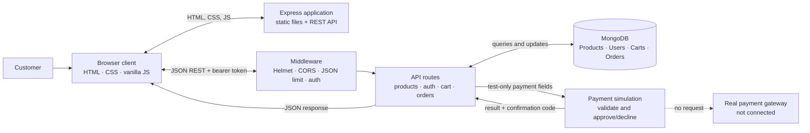

# SIA1102 E-commerce

## Zimora Market: Design and Implementation Report

**Group members:** [Insert names and student numbers]

**Institution:** [Insert institution]

**Submission date:** [Insert date]

> **Formatting note:** This report is prepared as a Markdown source. When submitted, apply the institution's required font, margins, line spacing and citation style. The screenshot callouts are placeholders for screenshots captured from the running application.

## 1. Introduction and project overview

Electronic commerce enables customers to discover, compare and purchase goods using a networked application rather than visiting a physical shop. This project applies that concept to **Zimora Market**, a prototype online shop for phones, laptops, audio products and accessories aimed at customers in Zimbabwe. The work was developed for SIA1102 E-commerce as a small, end-to-end demonstration of storefront design, customer accounts, shopping-cart management, data persistence and a simulated checkout.

The project has two related goals. First, it provides a clear customer journey: browse a catalogue, narrow results by category or search, inspect an item, add it to a bag, create an account or sign in, and submit an order. Second, it demonstrates how a browser interface communicates with a REST API and a document database. The interface uses semantic HTML, CSS and vanilla JavaScript; the server uses Node.js and Express; MongoDB persists the product, user, cart and order records through Mongoose models.

The catalogue is seeded with twelve example products in four categories. Product prices are displayed in US dollars. Guest visitors can browse and keep a local shopping bag; signing in merges that bag into the account cart. A registered customer can adjust quantities, remove items, and submit the cart through a simulated payment flow. The backend checks the current product price and stock, records an order result, and returns a confirmation code for an approved simulation.

The checkout is deliberately not a payment integration. It does not connect to a bank, EcoCash, Stripe, PayPal or another payment processor, and it must not be used with real payment details. The server validates example card or Zimbabwean mobile-money fields and uses documented test-only suffixes to demonstrate an approval or decline. It does not save the supplied card number, expiry or security code. The resulting order stores the selected payment method and simulated status, not card credentials.

The scope is a coursework prototype rather than a production retail platform. It does not provide live delivery pricing, tax calculation, product administration, email verification, password reset, shipment tracking, refunds, or an external gateway. These omissions are made explicit so that the implementation can demonstrate core e-commerce concepts without representing itself as a live merchant.

**Screenshot placeholder 1 — storefront:** Insert a full-page screenshot of the landing hero, benefits strip and product collection at desktop width.

**Screenshot placeholder 2 — mobile storefront:** Insert a screenshot of the catalogue at a narrow mobile viewport, showing the responsive product grid and filters.

## 2. System architecture

The design uses a browser client, a same-origin Express application and MongoDB. The browser requests static HTML, CSS and JavaScript from Express, then calls JSON endpoints under `/api`. The client sends a signed bearer token for account-specific endpoints. Express applies common security headers, CORS configuration, JSON body limits and authentication rate limiting; protected routes verify the token before reading or changing the user's cart or orders.

The server is responsible for business rules that must not be trusted to the browser. In particular, it reads product prices and stock from MongoDB when preparing an order rather than accepting a total supplied by the client. The order endpoint checks the cart, address, selected payment mode and payment-field format. It then executes the simulation branch and stores the result. A successful simulated checkout decrements stock and empties the account cart. A declined attempt is recorded with a declined status and leaves the cart available for another attempt.

The following diagram shows the main runtime components and the boundary between the local simulation and a real payment network.



**Diagram description.** The dotted gateway connection is intentionally inactive. Card and EcoCash examples terminate inside the local application; no payment authorization or settlement takes place. MongoDB is the persistent data store, while the browser keeps a guest cart and the signed-in session token in local storage.

### Request and response behavior

Product routes are public. `GET /api/products` supports category, text-search and sort query parameters; `GET /api/products/:id` returns one catalogue record. Registration and login are public but rate-limited. Authentication returns a JSON Web Token (JWT) with a seven-day expiry. The token is sent in an `Authorization: Bearer` header to `/api/auth/me`, cart endpoints and order endpoints.

Each user has an account cart. The browser can hold a guest bag before authentication; when a customer signs in, `/api/cart/sync` sends the guest product identifiers and quantities, and the API merges them with the stored account cart while respecting product stock. Cart routes support reading the cart, adding an item, changing quantity, removing an item and merging guest items.

`POST /api/orders` is the checkout boundary. The client submits delivery address, payment type and the corresponding test fields. The server loads the cart and current products, calculates the total from stored unit prices, checks stock and creates the result record. The response includes a success/failure result and, on either branch, a generated confirmation code. On success, inventory is reduced and the cart is cleared. The browser presents the processing state and then the API message and confirmation.

## 3. Database design

MongoDB stores four principal collections: `products`, `users`, `carts` and `orders`. Mongoose schemas define required fields, types, enum values, size constraints and indexes. This model combines references where data is independently managed (users and products) with embedded subdocuments where line items belong to one cart or order. The order copies the product name, image and unit price at checkout so a later catalogue edit does not change the historical order description or amount.

```mermaid
erDiagram
    USER ||--o| CART : owns
    USER ||--o{ ORDER : places
    CART ||--o{ CART_ITEM : contains
    PRODUCT ||--o{ CART_ITEM : referenced_by
    ORDER ||--|{ ORDER_ITEM : snapshots
    PRODUCT o|--o{ ORDER_ITEM : source_product

    USER {
        ObjectId _id PK
        string name
        string email UK
        string passwordHash
        string phone
        date createdAt
    }
    CART {
        ObjectId _id PK
        ObjectId user FK_UK
        date updatedAt
    }
    CART_ITEM {
        ObjectId product FK
        number quantity
    }
    PRODUCT {
        ObjectId _id PK
        string slug UK
        string name
        string category
        number price
        number stock
    }
    ORDER {
        ObjectId _id PK
        ObjectId user FK
        number total
        string paymentMethod
        string paymentStatus
        string confirmationCode UK
        string deliveryAddress
        date createdAt
    }
    ORDER_ITEM {
        ObjectId product FK
        string name
        string image
        number unitPrice
        number quantity
    }
```

**Diagram description.** `CART_ITEM` and `ORDER_ITEM` describe embedded arrays within MongoDB documents, not separate top-level collections. The product reference in an order is optional in practice because the order stores a snapshot and can remain meaningful if a product is removed later. Cart and order documents reference their owning user; one cart per user is enforced by a unique index.

### Collection schemas and constraints

| Collection | Main fields and constraints | Relationship and use |
|---|---|---|
| `products` | `name`, unique `slug`, enumerated `category`, description, non-negative `price`, optional `compareAtPrice`, image URL, rating from 0 to 5, and non-negative stock | Catalogue data read by browsing and checkout. It has a compound category/price index and a text index over name and description. |
| `users` | `name` (maximum 80 characters), unique normalized email, `passwordHash` excluded from query results by default, optional phone and timestamps | Account owner of a cart and orders. Passwords are hashed with bcrypt; the plaintext password is not stored. |
| `carts` | Unique `user` reference, embedded `items` containing product reference and quantity from 1 to 20, timestamps | One active cart per user. Product details are populated for display and totals; the cart itself does not store a price. |
| `orders` | User reference, embedded item snapshots, calculated total, payment method (`card` or `ecocash`), status (`paid` or `declined`), unique confirmation code, delivery address and timestamps | A durable record of each checkout attempt. The user/time index supports recent-order retrieval. |

The `products` collection is seeded with 12 demonstration records: three phones, three laptops, three audio products and three accessories. Catalogue values, prices and stock levels are sample coursework data rather than a representation of a real supplier's inventory. The user collection begins empty; a customer is added through registration. There are no administrative or staff roles in the current design.

The main relationships are as follows. A user has zero or one cart and can place multiple orders. A cart can contain zero or more embedded item lines, each referencing a product. An order belongs to one user and includes one or more embedded item snapshots. Each order line keeps the product identifier when available, plus the product name, image, price at purchase and quantity. This snapshot pattern preserves useful historical information when catalogue records change.

The database schema is a suitable starting point for a small catalogue, but it does not provide multi-document transactions for checkout. Inventory decrement and cart clearing currently happen as separate operations after the order is inserted. For a larger or concurrent store, those operations should be performed transactionally where the MongoDB deployment supports transactions, together with idempotent order handling and explicit reservation rules.

## 4. Payment simulation process

The payment path is designed to demonstrate validation, a processing state, an approval/decline result and an order confirmation without moving money. The client requires an address and requires only the fields for the chosen payment type. For a card simulation, it submits a card-like number, an `MM/YY` expiry and a three- or four-digit security code. For EcoCash, it submits a Zimbabwe-formatted mobile number. The API repeats the essential format checks because client-side validation alone can be bypassed.

After validation, the order endpoint loads the authenticated user's cart and populates current products. It rejects an empty cart or insufficient stock. It calculates the total using current server-side prices. The deterministic demo rule declines a card number whose last four digits are `0000` and an EcoCash number whose last two digits are `00`; other valid-looking values simulate approval. This rule is solely for reproducible coursework demonstrations and is not a payment authorization algorithm.

On approval, the API creates a `paid` simulation record, decrements inventory and clears the cart. The client displays the confirmation code and total. On decline, it creates a `declined` attempt record and displays a failure message; it does not clear the cart or decrement stock, so a customer can try again. Both statuses are visible in the order data. No provider transaction identifier exists because the application does not contact a provider.

```mermaid
sequenceDiagram
    actor Customer
    participant UI as Browser checkout
    participant API as Express orders route
    participant DB as MongoDB
    participant SIM as Payment simulation

    Customer->>UI: Choose card or EcoCash; enter details and address
    UI->>UI: Validate required fields and show processing state
    UI->>API: POST /api/orders (Bearer JWT, cart checkout data)
    API->>API: Verify JWT and validate address/payment format
    API->>DB: Read user's cart and current product prices/stock
    DB-->>API: Cart lines and catalogue records
    API->>API: Recalculate total; reject empty cart or low stock
    API->>SIM: Evaluate test-only suffix rule
    SIM-->>API: Simulated approved or declined result
    API->>DB: Save order with status and confirmation code
    alt Approved
        API->>DB: Decrement stock and clear user's cart
    else Declined
        Note over API,DB: Preserve cart and stock for retry
    end
    API-->>UI: JSON result, message and order reference
    UI-->>Customer: Confirmation or decline message
```

**Diagram description.** The sequence separates browser-side presentation from server-side validation and persistence. The simulation occupies the provider decision step but has no external network participant. Real payment credentials must never be used in a classroom demonstration.

**Screenshot placeholder 3 — checkout:** Insert a screenshot of the checkout form with the simulated-payment disclaimer visible. Use only obviously fictitious test values.

**Screenshot placeholder 4 — order result:** Insert a screenshot of one approved simulation showing its confirmation code. If useful, add a separate declined result to demonstrate both branches.

## 5. Usability and performance observations

### Usability

The storefront uses a restrained green and warm-neutral palette, a consistent wordmark treatment, descriptive product cards and a responsive layout. The catalogue exposes category chips, a search field and a sort selector close to the product grid. Each product card provides a price, category, rating, optional badge and quick-add action; selecting the card opens a detail view. The bag shows quantity controls, removal actions and a running subtotal. Checkout separates the two payment choices and changes visible/required fields according to the selected option.

The interface supports keyboard activation of product cards, labels form controls, uses descriptive button labels and exposes product loading/result messages through live regions. It includes an Escape-key close behavior for overlays and a reduced-motion CSS preference. Those measures improve baseline usability but do not replace testing with keyboard-only users or assistive technology. A production accessibility assessment should verify focus trapping, focus restoration, contrast ratios, screen-reader announcements and form error association. The current modal overlays do not implement a full focus trap.

The CSS has tablet/desktop and mobile breakpoints at approximately 900 and 650 pixels. On narrow screens the navigation is simplified, category chips can scroll horizontally, product cards become a two-column grid, and the cart and checkout surfaces adapt to the viewport. Product images use lazy loading in the catalogue. The hero image, product photography and web fonts are hosted remotely; this improves the visual presentation without bundling large media files but means those assets depend on network availability and their third-party hosts.

### Performance and error handling

The API limits the product listing to 60 results, has a text index for product search and an index for category/price filtering. Product cards request images lazily. The application does not yet paginate, cache responses, generate responsive image variants or measure Core Web Vitals. The fonts and images may contribute more to perceived load time than the small vanilla JavaScript client, but that is a design expectation and has not been measured on a deployed page.

The frontend displays loading and empty states, reports API errors in a toast or form message, prevents repeated checkout submission while the simulated request is in progress, and preserves a guest bag in local storage. The server returns client-facing status messages for expected validation, authentication, missing-record and insufficient-stock errors. It uses a request body limit, security headers, an authentication rate limit, bearer-token verification and bcrypt password hashes. The local demo uses HTTP and local storage for its JWT, so it is not an appropriate production security configuration. Cross-site scripting prevention and stronger security controls remain important, especially because a stolen local-storage token can be read by injected script.

### Testing results and limitations

The initial startup attempt was blocked because MongoDB was not installed. With approval, MongoDB Community Server 9.0.4 was installed locally, the product seed completed, and the site was started at `http://localhost:3000`. The home page returned HTTP 200, `/api/health` returned `ok`, and the product endpoint returned twelve seeded records. A browser check searched for “Nova” and returned one match; adding the item to the guest bag, increasing its quantity to two, and removing it updated the displayed bag count and subtotal as expected. The first narrow-viewport check exposed horizontal overflow in the category scroller; its width was corrected to stay within the parent, and a repeat check found no document-level horizontal overflow. An accessibility warning on the open cart drawer was also addressed by synchronizing its `aria-hidden` state and returning focus to the bag control when it closes.

An API integration check registered a temporary test account, authenticated it, added a product to its cart, exercised both approved and declined card simulation branches, and retrieved two order attempts. The temporary account, its cart and orders were deleted afterward, and the product's stock was restored to its initial value. No real payment credentials were used. These results establish that the main local flow runs, but they do not represent a production load or a formal usability study.

| Check | Result | Interpretation |
|---|---|---|
| JavaScript syntax checks | Passed | Server, route, seed and browser scripts parse successfully. |
| Package/dependency checks | Passed | Package JSON is valid; dependency audit reported no vulnerabilities at the final check. |
| MongoDB and seed | Passed | MongoDB Community Server 9.0.4 accepted local connections; `npm run seed` inserted 12 products across four categories. |
| HTTP and catalogue | Passed | Homepage returned HTTP 200; health endpoint returned `ok`; product API returned 12 records. |
| Browser search and guest bag | Passed | “Nova” returned one product; adding, incrementing to quantity two, and removing the item updated the badge and subtotal. |
| Account/cart/order API flow | Passed | Temporary registration, authenticated cart, simulated approval, simulated decline and order-history retrieval all completed; test records and stock changes were cleaned up. |
| Mobile-width layout | Passed after correction | A narrow viewport test found category-scroller overflow; after constraining it to its parent, the document had no horizontal overflow. |
| Page-load performance | Not measured | No repeatable performance profile or Core Web Vitals measurement was collected; no timing claim is made. |

The completed checks are focused smoke and integration tests, not exhaustive quality assurance. Further testing should cover duplicate-email registration; correct and incorrect login; all category and sort options; merging a guest bag into a signed-in cart; quantity and stock boundaries; empty-cart checkout; invalid card and EcoCash inputs; mobile and desktop behavior across browsers; and keyboard/screen-reader usability. Performance should be measured on a repeatable build and network profile, with device, browser, cache state and metric recorded.

**Screenshot placeholder 5 — responsive behavior:** Insert paired desktop and mobile captures of the catalogue after the app has been run with MongoDB and seeded data. The screenshots are intentionally left for the group to capture and label.

## 6. Recommendations for scaling

1. **Cloud hosting and configuration.** Deploy the Node.js service to a managed platform and MongoDB to a managed replica set. Store database credentials and JWT secrets in a managed secret store, separate development/staging/production environments, enable TLS end to end and configure backups, retention and restore drills. Use a stable production domain and an explicit CORS allowlist.

2. **Horizontal scaling and load balancing.** Keep Express application instances stateless so multiple instances can sit behind a load balancer. The current JWT approach avoids server-side session affinity, but token revocation and key rotation need a planned strategy. Add health/readiness endpoints that distinguish process health from database readiness, and monitor error rates, response latency and saturation.

3. **Caching and content delivery.** Add a CDN for versioned static assets and appropriately cached product imagery. Use browser cache headers and image transformations to deliver AVIF/WebP and correctly sized responsive variants. Cache public catalogue responses with short, explicit invalidation rules; do not cache authenticated cart/order responses in shared caches. Search query and sort needs should be profiled before choosing application or database caches.

4. **Database indexes and consistency.** Measure real query plans before adding indexes. Existing product text/category indexes, unique email/slug constraints and order history index should be reviewed against production query patterns. Add pagination and a stable sort to the catalogue. Use MongoDB transactions or a carefully designed inventory reservation process for order creation, inventory decrement and cart clearing. Add idempotency keys to prevent duplicate orders after client retries, and make confirmation-code collision handling explicit.

5. **Real payment gateway integration.** Replace the simulation with a provider's hosted checkout or official client/server SDK, such as Stripe Checkout or PayPal Orders, after confirming legal, geographic, currency and merchant-account availability for the intended market. The server should create the payment session from a server-calculated order total; the browser should receive only the provider's safe redirect/client data. Treat signed provider webhooks as the authoritative payment status, verify their signatures, and reconcile asynchronous success, failure, cancellation and refunds. Never store CVV, raw card numbers or payment secrets. A production integration must also meet applicable PCI DSS responsibilities and privacy obligations.

6. **Security hardening.** Move access tokens from local storage to appropriately configured secure, HttpOnly cookies or adopt a short-lived access-token and refresh-token design with rotation. Enforce HTTPS, use strict CSP and output encoding, validate request bodies with shared schemas, rate-limit sensitive routes including login and checkout, protect against account enumeration and abuse, and add audit logging that excludes credentials and payment details. Add email verification, password-reset flows, MFA where appropriate, dependency update monitoring and security tests. Use a threat model and an established control set such as OWASP ASVS before handling real customer data.

7. **Operational readiness and user experience.** Add structured logs, tracing, uptime monitoring, database backup alerts and incident procedures. Introduce order status history, notifications, shipping/tax rules, refund and cancellation workflows, and customer-support contact details. Test accessibility with automated checks and manual keyboard/screen-reader review, and conduct usability sessions with intended Zimbabwean users, including low-bandwidth conditions and mobile devices.

These are recommendations, not features currently claimed by the prototype. Scaling should follow measured demand and operational requirements rather than adding infrastructure before the basic flows have been verified.

## 7. Conclusion

Zimora Market demonstrates the core architecture and customer journey of a small e-commerce application. It combines a responsive vanilla-JavaScript storefront with Express REST routes, MongoDB/Mongoose data models, account authentication, guest and authenticated carts, product stock checks, order records and a safe-to-demonstrate payment simulation. Its design makes the boundary between an educational simulation and a real payment system explicit.

The implementation provides a useful foundation for the SIA1102 group project, but it is not yet a production shop. The development environment did not have MongoDB available, so database-backed startup, seeded catalogue browsing and end-to-end checkout were not verified in this run. The next steps are to provision MongoDB, run the seed script, exercise the documented functional cases, capture the requested screenshots, and record measured usability and performance evidence. A later production-oriented iteration should focus on atomic order/inventory operations, stronger authentication and token handling, accessibility validation, monitoring and a compliant integration with a real payment provider.

## 8. References

1. Express.js. (n.d.). *Express: Fast, unopinionated, minimalist web framework for Node.js*. https://expressjs.com/ (Accessed 19 November 2026).
2. MDN Web Docs. (n.d.). *Responsive design*. https://developer.mozilla.org/en-US/docs/Learn_web_development/Core/CSS_layout/Responsive_Design (Accessed 19 November 2026).
3. MongoDB, Inc. (n.d.). *Data modeling*. MongoDB Manual. https://www.mongodb.com/docs/manual/data-modeling/ (Accessed 19 November 2026).
4. Mongoose. (n.d.). *Schemas*. Mongoose Documentation. https://mongoosejs.com/docs/guide.html (Accessed 19 November 2026).
5. Node.js. (n.d.). *About Node.js*. https://nodejs.org/en/about (Accessed 19 November 2026).
6. OWASP Foundation. (n.d.). *Authentication Cheat Sheet*. OWASP Cheat Sheet Series. https://cheatsheetseries.owasp.org/cheatsheets/Authentication_Cheat_Sheet.html (Accessed 19 November 2026).
7. OWASP Foundation. (n.d.). *Password Storage Cheat Sheet*. OWASP Cheat Sheet Series. https://cheatsheetseries.owasp.org/cheatsheets/Password_Storage_Cheat_Sheet.html (Accessed 19 November 2026).
8. OWASP Foundation. (n.d.). *Input Validation Cheat Sheet*. OWASP Cheat Sheet Series. https://cheatsheetseries.owasp.org/cheatsheets/Input_Validation_Cheat_Sheet.html (Accessed 19 November 2026).
9. PCI Security Standards Council. (n.d.). *PCI Data Security Standard (PCI DSS)*. https://www.pcisecuritystandards.org/standards/pci-dss/ (Accessed 19 November 2026).
10. Stripe. (n.d.). *Checkout*. Stripe Documentation. https://docs.stripe.com/checkout (Accessed 19 November 2026).
11. PayPal. (n.d.). *Orders API*. PayPal Developer Documentation. https://developer.paypal.com/docs/api/orders/v2/ (Accessed 19 November 2026).
12. Fielding, R., Nottingham, M., & Reschke, J. (2022). *HTTP Semantics* (RFC 9110). Internet Engineering Task Force. https://www.rfc-editor.org/rfc/rfc9110 (Accessed 19 November 2026).
